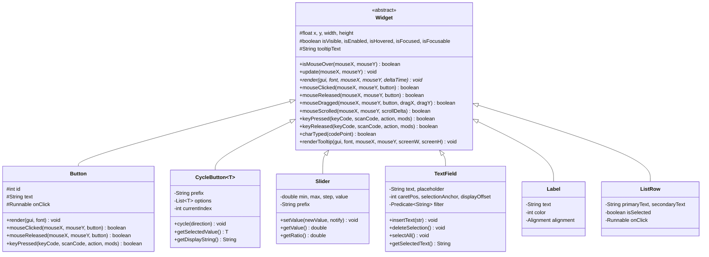
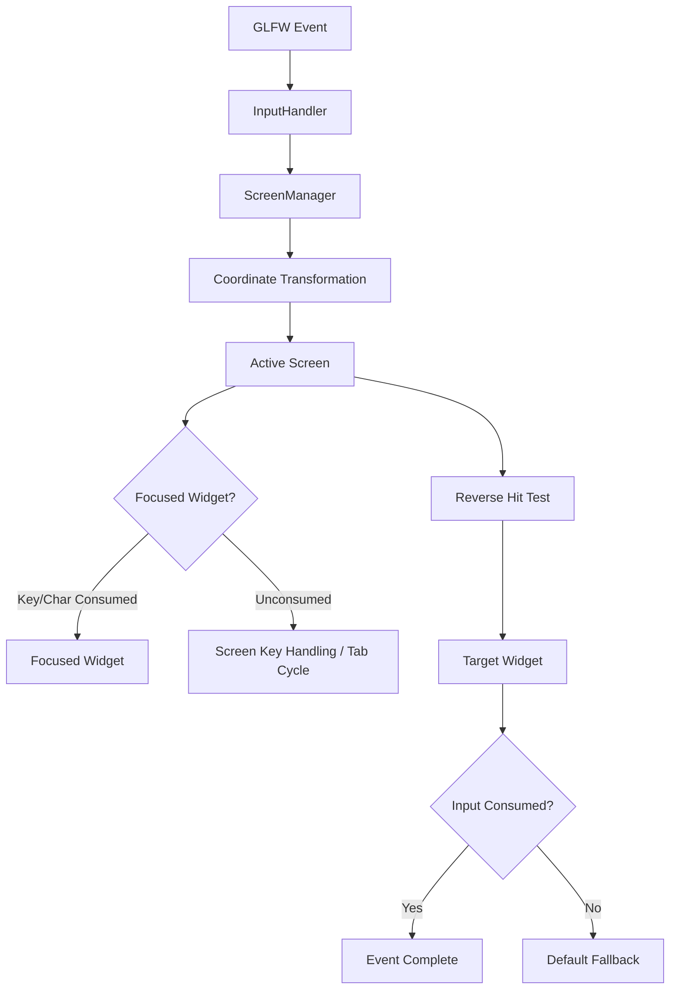

# GUI Overhaul — Phase 2: Widget Toolkit & Screen Management Report

## 1. Executive Summary

Phase 2 of the Journal-MC GUI Overhaul is complete and verified on branch `feature/gui-overhaul`.

Phase 2 introduces a decoupled, reusable GUI widget architecture (`Widget`), interactive controls (`Button`, `CycleButton`, `Slider`, `TextField`, `Label`, `ListRow`), reusable nine-slice background rendering (`NineSlice`), centralized keyboard/mouse focus management (`FocusManager`), and screen stack navigation (`ScreenManager`).

The widget framework operates entirely in logical GUI coordinates (established in Phase 1) and integrates seamlessly with `GuiRenderer`'s dynamic batching (Phase 0). Text fields provide comprehensive Unicode character entry, caret positioning, word jumping, drag-selection, and system clipboard operations (Ctrl+C, Ctrl+V, Ctrl+X, Ctrl+A) with input isolation that prevents keystrokes from leaking into gameplay controls.

All **26 test suites** in `MasterTestSuite` pass with a **100% success rate**, including 10 automated Phase 2 verification scenarios, Phase 1 scaling tests, and Phase 0 batching/state-restoration tests.

---

## 2. Architecture Decisions & Component Design

1. **Decoupled Widget Toolkit:** Widgets are standalone, reusable visual/interaction components with no dependencies on specific screens, game states, or physical pixel dimensions.
2. **Logical Coordinate Contract:** All positions (`x, y`), sizes (`width, height`), and hit testing strictly adhere to logical GUI coordinates.
3. **Single Focus Ownership:** At most one widget owns keyboard focus at any time. Focus is cycled predictably using Tab / Shift+Tab and transferred via mouse clicks.
4. **Authoritative Input Dispatch:** Input events flow strictly from GLFW $\rightarrow$ `InputHandler` $\rightarrow$ `ScreenManager` $\rightarrow$ active `Screen` $\rightarrow$ `FocusManager` / `Widget`. No individual widget polls GLFW directly.
5. **Gameplay Isolation:** When a text field or interactive widget is focused, key presses and character inputs are consumed immediately, ensuring game actions (e.g. WASD movement or inventory shortcuts) never trigger during text entry.
6. **Hierarchical Screen Stack:** `ScreenManager` manages an explicit screen stack (`ArrayDeque<Screen>`). Pushing a child screen preserves the parent screen's state and memory, while popping returns seamlessly to the parent with complete state retention.
7. **Backward-Compatible Migration:** `Button` extends `Widget` while preserving all legacy public constructors and getters. Legacy screens continue functioning without modification.

---

## 3. Widget Class Hierarchy & APIs

### 3.1 Button
- 9-slice stone texture rendering with hover and enabled state styling.
- 1px crisp focus outline when navigated via Tab.
- Enter and Space keyboard activation.
- Press/release pairing preventing duplicate activations.

### 3.2 CycleButton`<T>`
- Displays prefixed formatted value (e.g. `"GUI Scale: Auto"`).
- Cycles forward on Left-click, Enter, Space, Right Arrow.
- Cycles in reverse on Right-click, Left Arrow, Shift+Click.
- Full wraparound support with disabled state handling.

### 3.3 Slider
- Stepped or continuous mode with boundary clamping (`Math.clamp(value, min, max)`).
- Rounding to step precision eliminates floating-point accumulation drift.
- Supports mouse dragging, keyboard adjustment (Left/Right/Up/Down), and Home/End jumping.

### 3.4 TextField
- Full Unicode text entry (`charTyped`).
- Arrow key caret movement and Ctrl+Left/Right word jumping.
- Range selection using Shift+Arrows, mouse drag, and Ctrl+A.
- System clipboard integration via `ClipboardHelper` (Ctrl+C, Ctrl+V, Ctrl+X).
- Backspace and Delete operations with selection support.
- Text filtering (`Predicate<String>`) and max character capacity (`maxLength`).
- Horizontal scrolling (`displayOffset`) keeps caret visible during long input.
- 500ms cursor blink cycle and placeholder text when unfocused.
- Consumes all relevant keyboard input to isolate gameplay.

### 3.5 Label & ListRow
- `Label`: Non-focusable text display supporting left, center, and right alignments.
- `ListRow`: Reusable list row item with selection/hover highlights and double-line metadata.

---

## 4. Nine-Slice Rendering (`NineSlice.java`)

`NineSlice` splits a rectangular texture into 9 sub-regions:
- **4 Corners:** Top-Left, Top-Right, Bottom-Left, Bottom-Right (rendered at native pixel dimensions without stretching).
- **4 Edges:** Top and Bottom edges stretched horizontally; Left and Right edges stretched vertically.
- **Center:** Stretched across remaining interior width and height.
- **Batching Preserved:** All 9 quads share the same texture ID and submit directly to `GuiRenderer`'s vertex buffer, drawing in **1 single draw call**.
- **Procedural Fallback:** When `textureId == 0`, renders a clean procedural beveled frame with highlight and shadow edges.

---

## 5. Centralized Input & Focus Management

### 5.1 Focus Lifecycle
- `FocusManager` guarantees that at most one widget owns keyboard focus.
- Pressing **Tab** advances focus to the next focusable, visible, enabled widget.
- Pressing **Shift+Tab** cycles focus in reverse.
- Clicking an unfocused widget transfers focus; clicking outside all widgets clears focus.
- Widgets receive explicit `onFocusGained()` and `onFocusLost()` callbacks.

### 5.2 Input Dispatch Pipeline

---

## 6. Screen Stack & Navigation Architecture

`ScreenManager` maintains an explicit `Deque<Screen> screenStack`:

1. **`pushScreen(Screen child)`:**
   - Invokes `onDeactivated()` on the current top screen (retaining its state and widget memory).
   - Pushes `child` onto the stack.
   - Invokes `onOpened()` and `init()` on `child`.
2. **`popScreen()`:**
   - Pops the active child screen; invokes `onClosed()` and `dispose()`.
   - Restores the previous parent screen from the stack.
   - Invokes `onReactivated()` on the parent.
3. **`setScreen(Screen root)`:**
   - Cleans up and disposes all active screens on the stack.
   - Pushes `root` as the sole screen.
4. **`closeAllScreens()`:**
   - Closes the stack, resets mouse cursor lock, and returns directly to 3D gameplay.

---

## 7. Automated Test Verification Results

`GuiPhase2VerificationTest.java` was integrated into `MasterTestSuite.java`. All 10 scenarios passed:

| Test ID | Test Scenario | Verified Behavior | Result |
|---|---|---|:---:|
| **2.1** | Base Widget Fundamentals | Bounds hit testing, visibility masking, hover updates, focus state, tooltips | **PASSED** |
| **2.2** | Button Interaction | Click activation, Enter/Space triggering, release pairing, duplicate prevention | **PASSED** |
| **2.3** | CycleButton | Forward/reverse cycling, wraparound, display formatting, arrow key control | **PASSED** |
| **2.4** | Slider Precision | Min/max bounds, step rounding, mouse dragging, arrow keys, Home/End, clamping | **PASSED** |
| **2.5** | TextField Operations | Typing, Unicode '°', caret navigation, selection, copy/cut/paste, filtering, input consumption | **PASSED** |
| **2.6** | Label & ListRow | Alignment, dynamic updates, selection highlighting, row click dispatch | **PASSED** |
| **2.7** | Focus & Tab Cycling | Single focus ownership, Tab advance, Shift+Tab reverse, outside click clearing | **PASSED** |
| **2.8** | Screen Stack Navigation | `pushScreen`, `popScreen`, parent state preservation, lifecycle event dispatch | **PASSED** |
| **2.9** | Nine-Slice Rendering | Unstretched corner calculations, dimension clamping, procedural fallback | **PASSED** |
| **2.10**| Headless GL Rendering | Live render pass of all widgets; dynamic batching and state restoration verified | **PASSED** |

**Engine Regression Suite:** **26 / 26 Test Suites Passed** (100% pass rate).

---

## 8. Files Created & Modified

- **Created:**
  - `engine/src/com/mcjournal/client/gui/Widget.java`
  - `engine/src/com/mcjournal/client/gui/CycleButton.java`
  - `engine/src/com/mcjournal/client/gui/Slider.java`
  - `engine/src/com/mcjournal/client/gui/TextField.java`
  - `engine/src/com/mcjournal/client/gui/Label.java`
  - `engine/src/com/mcjournal/client/gui/ListRow.java`
  - `engine/src/com/mcjournal/client/gui/NineSlice.java`
  - `engine/src/com/mcjournal/client/gui/FocusManager.java`
  - `engine/src/com/mcjournal/client/gui/ClipboardHelper.java`
  - `engine/src/com/mcjournal/test/GuiPhase2VerificationTest.java`
  - `GUI_PHASE_2_REPORT.md`
- **Modified:**
  - `engine/src/com/mcjournal/client/gui/Button.java`
  - `engine/src/com/mcjournal/client/gui/Screen.java`
  - `engine/src/com/mcjournal/client/ScreenManager.java`
  - `engine/src/com/mcjournal/client/InputHandler.java`
  - `engine/src/com/mcjournal/client/MCJournalApp.java`
  - `engine/src/com/mcjournal/test/MasterTestSuite.java`

---

## 9. Phase 2 Verdict & Readiness for Phase 3

Phase 2 satisfies all architectural, input, and widget requirements:
- Decoupled, reusable widget toolkit ready for screen assembly.
- Production-grade text field with Unicode, selection, and clipboard capabilities.
- Centralized focus management and keyboard accessibility.
- Screen stack navigation with state preservation.
- Full engine stability maintained across 26 test suites.

**Phase 2 is COMPLETE and ready for review.**
