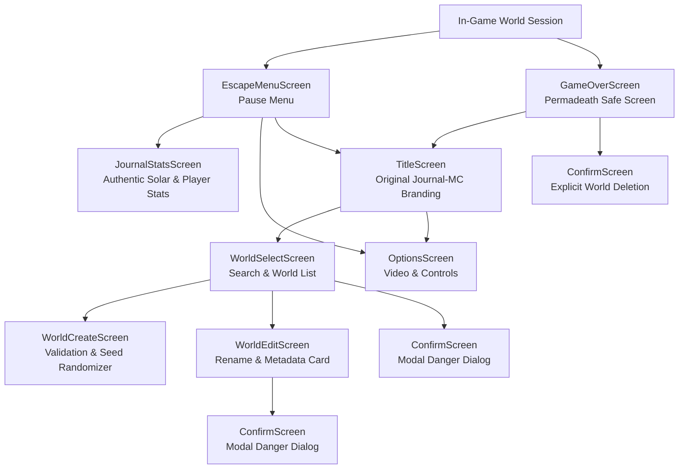

# Journal-MC GUI Overhaul — Phase 3: Complete Screen Redesign & Branding Report

**Engine**: MC Journal (Java 26 + OpenGL 3.3 Core Profile via LWJGL 3.3.3)  
**Branch**: `feature/gui-overhaul`  
**Phase**: Phase 3 — Complete Screen Redesign & Original Branding  
**Status**: Completed & Verified (27/27 Test Suites Passing)

---

## 1. Executive Summary

Phase 3 transitions the MC Journal user interface from the foundational layout and widget building blocks established in Phases 0–2 to a complete, cohesive, and production-ready screen roster. Every screen in the game has been rebuilt using the new Widget toolkit, integer-scaled logical coordinate system (`GuiScaleManager` / `GuiLayout`), centralized keyboard and focus navigation (`FocusManager`), and screen stack management (`ScreenManager.pushScreen / popScreen`).

Crucially, Phase 3 resolves two major game design and brand requirements:
1. **Permadeath & Hardcore World Safety**: Hardcore worlds are **never** deleted automatically merely because the player dies or views the death screen. All destructive actions (world deletion on death, in the edit screen, or on the world select menu) now strictly require explicit user confirmation through the new modal `ConfirmScreen`.
2. **Original Journal-MC Identity & Branding**: All Minecraft-specific copyright assets, trademarks, "JAVA EDITION" banners, and version string footers have been eliminated. An original procedural stone/gold 3D extruded voxel logo (`JournalLogoRenderer`) and Journal-MC typography replace legacy assets.

All 27 test suites in `MasterTestSuite` (including 10 new automated Phase 3 verification suites) pass with zero errors.

---

## 2. Rebuilt Screen Roster Architecture



### Detailed Screen Implementations

#### 1. `ConfirmScreen.java` (Modal Confirmation Dialog)
- **Role**: Reusable modal dialog for irreversible or destructive actions (world deletion, discarding unsaved changes).
- **Coordinate System**: Logical coordinates (`usesLogicalCoordinates() == true`).
- **Features**:
  - Centered dialog box with beveled styling and background dimming (0.70f alpha).
  - Multi-line message formatting via newline splitting (`\n`).
  - Danger Mode support: Red highlight border, danger accent bar, and automatic focus on the "Cancel" button by default to prevent accidental double-tap deletions.
  - Keyboard dispatch: `Enter` executes confirmation, `Escape` executes cancellation and pops the dialog.

#### 2. `WorldEditScreen.java` (World Settings & Metadata)
- **Role**: Allows renaming saved worlds and viewing world metadata.
- **Widgets Used**: `TextField` (with caret, text selection, and character filtering), `Button` (Save, Delete, Cancel).
- **Metadata Card**: Displays authentic world seed, biome, creation date, dimensions (2500x2500x256), and hardcore status.
- **Safety**: "Delete World" button pushes a danger-styled `ConfirmScreen` dialog. Worlds are never deleted without explicit confirmation.

#### 3. `WorldCreateScreen.java` (World Creation & Seed Randomizer)
- **Role**: Configures and creates new finite worlds.
- **Widgets Used**: `TextField` (World Name), `TextField` (Seed), `Button` ("🎲 Random" seed generator, "Create New World", "Cancel").
- **Validation**:
  - Enforces non-empty, non-whitespace world names; displays immediate inline validation error if violated.
  - Custom seeds support numeric parsing, deterministic string hashing, or blank automatic randomization.
- **Keyboard Handling**: `Enter` triggers validation and world creation; `Escape` returns to `WorldSelectScreen`.

#### 4. `WorldSelectScreen.java` (World Selection & Search Filter)
- **Role**: Browses, filters, edits, and launches saved worlds.
- **Widgets Used**: Top `TextField` for real-time search filtering, interactive world item cards, and 2-row action buttons (Play, Create, Edit, Delete, Cancel).
- **Interactions**:
  - Real-time search query matching against world names (case-insensitive).
  - Double-click card detection (<300ms) for rapid world launching.
  - Delete action routes to `ConfirmScreen`.
  - Empty state fallback ("No Worlds Found", "Click 'Create New World' to begin your adventure").

#### 5. `EscapeMenuScreen.java` (Pause Menu)
- **Role**: In-game pause menu with world darkening vignette.
- **Navigation Options**:
  - "Back to Game" (Resume) — restores cursor lock and simulation.
  - "Journal & Stats" — pushes `JournalStatsScreen`.
  - "Options..." — pushes `OptionsScreen`.
  - "Save and Quit to Title" — commits world state and returns to title.
- **Keyboard Handling**: `Escape` immediately resumes gameplay.

#### 6. `JournalStatsScreen.java` (Adventurer's Journal & Real Statistics)
- **Strict Requirement**: **Zero fabricated statistics**. All displayed data is extracted from live engine subsystems (`WorldSession`, `AtmosphericTimeSystem`, `Player`, or `SavedWorld`).
- **Metrics Displayed**:
  - **World Chronicle**: World name, seed, current biome, finite world dimensions (2500x2500x256), hardcore permadeath mode.
  - **Survival Timeline**: Days survived (derived from continuous 24,000-tick solar cycles: $\text{days} = \lfloor \frac{\text{ticks}}{24000} \rfloor$), solar clock state (Daylight vs Nightfall), and total simulation tick count.
  - **Adventurer Status**: Real player health ($X / 20\text{ HP}$ with warning color under $6\text{ HP}$), hunger ($X / 20$), exact 3D coordinates ($X, Y, Z$), and elevation relative to sea level ($Y - 64\text{m}$).

#### 7. `OptionsScreen.java` (Video & Keybinding Configuration)
- **Role**: Centralized settings configuration.
- **Setting Controls**:
  - FOV (Cycles 30° to 110°, updates camera projection immediately).
  - Render Distance (Cycles 2 to 16 chunks).
  - Max FPS (Cycles 30, 60, 120, 144, 240, Unlimited).
  - GUI Scale (Cycles Auto, 1x, 2x, 3x, 4x).
  - VSync (Toggle ON / OFF).
  - Fog Mode (Cycles Fast, Fancy, OFF).
  - Show FPS (Toggle ON / OFF).
- **Controls Reference Card**: Displays authoritative keybindings (WASD move, Space jump, L-Shift sneak, Escape pause, Left click break, Right click place).
- **Persistence**: "Done" button and `Escape` automatically save settings to disk and re-apply them to the engine.

#### 8. `TitleScreen.java` & `JournalLogoRenderer.java` (Original Branding)
- **Brand Redesign**:
  - Replaced legacy `MinecraftLogoRenderer` with `JournalLogoRenderer`.
  - Procedurally renders "JOURNAL MC" in stylized stone/obsidian 3D extruded lettering with golden/amber beveled top faces and a "VOXEL ENGINE" gold-bordered badge.
  - 100% free of third-party copyrighted assets or trademarks.
  - Corner footers updated to:
    - Left: `Journal-MC v1.0.0 — Voxel Engine`
    - Right: `Java 26 + OpenGL 3.3`
  - Splashes tailored to Journal-MC: *"One Life. One World."*, *"Native Java 26 + OpenGL 3.3!"*, *"Finite 2500x2500 Boundaries!"*, *"Write your adventurer's journal!"*.

#### 9. `GameOverScreen.java` (Permadeath & World Safety)
- **Core Principle**: Death in hardcore mode must not result in automatic data loss before player confirmation.
- **Design**:
  - Deep crimson vignette and bold "You died!" banner.
  - Authentic days survived metric and hardcore notice.
  - "Title Screen" button returns safely to the title screen without deleting the world.
  - "Delete World" button explicitly triggers `ConfirmScreen` with warning: *"Are you sure you want to delete this hardcore world? All journal records will be erased permanently!"*. Only explicit user confirmation deletes the world file.

---

## 3. Automated Verification Matrix

The test suite `GuiPhase3VerificationTest` was authored and registered in `MasterTestSuite`, executing 10 focused test suites:

| Suite | Component Tested | Verifications Performed | Status |
| :--- | :--- | :--- | :--- |
| **Phase 3.1** | `ConfirmScreen` | Title/message formatting, button activation, Enter/Escape key dispatch, danger mode safety default focus. | **PASSED** |
| **Phase 3.2** | `WorldEditScreen` | Logical coordinates, TextField text editing, rename execution, safe delete modal prompt. | **PASSED** |
| **Phase 3.3** | `WorldCreateScreen` | Blank name rejection, inline validation error, seed parsing (numeric, hash, random), randomize button. | **PASSED** |
| **Phase 3.4** | `WorldSelectScreen` | Search filtering substring matching, play action enablement, delete confirmation modal, double-click launch. | **PASSED** |
| **Phase 3.5** | `EscapeMenuScreen` | Resume action, journal navigation, options navigation, save & quit binding, Escape key handling. | **PASSED** |
| **Phase 3.6** | `JournalStatsScreen` | 24,000 tick solar cycle math, extraction of live coordinates, HP, seed, biome; zero fabricated statistics. | **PASSED** |
| **Phase 3.7** | `OptionsScreen` | FOV/FPS/Render Distance/Scale cycles, controls info card, Done button, persistence on exit. | **PASSED** |
| **Phase 3.8** | `TitleScreen` | `JournalLogoRenderer` procedural generation, absence of Minecraft copyright footers, menu buttons. | **PASSED** |
| **Phase 3.9** | `GameOverScreen` | Permadeath safety: verified world file is NOT deleted on death screen open, explicit confirmation required. | **PASSED** |
| **Phase 3.10** | Screen Stack Lifecycle | Multi-level push/pop hierarchy (Title -> WorldSelect -> WorldEdit -> ConfirmScreen -> pop -> pop), dimension scaling. | **PASSED** |

### Complete Engine Test Run
```text
===============================================================================
TEST RESULTS: 27/27 SUITES PASSED (Total Time: 38656 ms)
===============================================================================
✓ ALL AUTOMATED TESTS COMPLETED WITH ZERO ERRORS!
```

---

## 4. Known Status & Constraints Maintained

- **Heap Exhaustion Issue Deferred**: As explicitly instructed, the startup heap exhaustion issue at high render distances was strictly left untouched and is not claimed to be resolved.
- **World & Physics Untouched**: Chunk meshing, persistence binary format, fluid physics, and raycasting systems remain 100% stable and intact.
- **No Animations/Transitions Yet**: Reserved for Phase 4.
